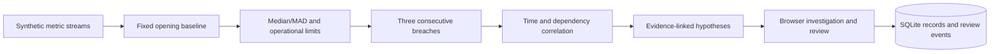

# Incident Atlas

**Follow an incident from scattered signals to an evidence-backed next check.**

Incident Atlas is a Python application for investigating reproducible service
incidents. It detects sustained changes in telemetry, groups related findings
using service dependencies, and gives an operator hypotheses with the exact
observations that support them. A reviewer can record notes and change an
incident's state without executing any infrastructure action.

**For a reviewer:** open the app, replay **Two independent faults**, and select
each incident. The database/checkout fault stays separate from catalog CPU
pressure even though they overlap in time. Inspect the baseline and peaks,
then save a review. Replay **Healthy baseline** to see the quiet state.

## What problem does it solve?

An incident often arrives as several alerts across connected services.
Investigators need to distinguish a related chain from an unrelated fault,
inspect the evidence, and record what they checked. This project makes those
steps visible in one browser workspace.

The public showcase uses **synthetic telemetry**, not a production connection.
All four scenarios execute the actual detection and correlation code. The
hypotheses are deterministic, rule-based suggestions; no LLM is silently
simulated and no generated probability is presented as confidence.

## Run locally

Python 3.12 or newer is required. No model key, Docker socket, database server,
external CDN or paid API is needed.

```bash
python3 -m venv .venv
source .venv/bin/activate
pip install -r requirements-dev.txt
uvicorn atlas.app:app --host 127.0.0.1 --port 8104
```

Open [the investigation workspace](http://localhost:8104/) or
[the local API reference](http://localhost:8104/docs). The source ships every
frontend asset. API reference content is generated from `/openapi.json` using
local JavaScript, so documentation does not break when an external CDN fails.

```bash
python -m pytest -q
ruff check atlas tests scripts
python scripts/evaluate.py
```

Docker alternative:

```bash
docker build -t incident-atlas .
docker run --rm -p 8104:8104 incident-atlas
```

## Architecture and decisions



| Component | Responsibility | Why this design |
|---|---|---|
| `atlas/domain.py` | Telemetry fixtures, statistical detection, graph traversal, incident grouping, hypothesis rules | Pure functions make scenario behavior reproducible and independently testable |
| `atlas/store.py` | Parameterized SQL, transactions, session-scoped records, event history and bounded retention | SQLite keeps a single-process demonstration straightforward to run |
| `atlas/app.py` | Validated HTTP requests, session cookie, origin checks, routes and security headers | Transport and business logic have separate boundaries |
| `static/` | Responsive queue, latency chart, evidence desk, filters and review form | Evidence and state are explicit, including loading/error/healthy states |
| `scripts/evaluate.py` | Repeatable synthetic scenario evaluation | Published results are generated rather than entered by hand |

**Detection:** each service/metric uses the first 50 observations to establish
a median and median absolute deviation. A robust z-score above 6 or a fixed
operational limit marks an observation; three consecutive marks become a
finding. The baseline is frozen before faults begin at minute 60. Median/MAD
is less sensitive to isolated baseline outliers than a mean/standard deviation.

**Grouping:** findings form connected components when their windows overlap
within five minutes and their services have a dependency path. Reachability
uses a visited set, so cycles cannot cause an infinite loop. Time coincidence
alone cannot join the independent catalog branch to checkout.

**Diagnosis:** rules recognize patterns such as pool pressure followed by
upstream degradation. Each hypothesis lists finding IDs and a next check.
The application deliberately says **may**, because temporal correlation and
the dependency graph do not prove a root cause.

## Results and what they mean

See [the generated evaluation report](docs/evaluation.json). It evaluates 20
healthy runs and 60 fault runs with seeds **1000–1019**, separate from the
showcased seed 42. The report measures healthy-run false positives and whether
each known scenario yields its expected incident count. It does **not** measure
unseen fault detection, causal accuracy, business savings, uptime or MTTR.

Tests cover baseline noise, isolated spikes, reversed input order, independent
fault separation, hypothesis evidence references, database persistence,
cross-session access denial, retention, invalid inputs and frontend/API assets.
GitHub Actions reruns tests, lint and the synthetic evaluation and retains its
report as an artifact. Local checks do not establish hosted CI success.

## How does this relate to Signal0ne?

Signal0ne's Docker incident workflow was the architectural reference: gather
context, surface an issue, inspect it and suggest an investigation direction.
This is a **new implementation**, with no copied upstream source or assets.
It uses FastAPI/SQLite and a browser evidence desk instead of reproducing the
Docker extension, Go backend, Angular UI or external LLM agent.

[Reference analysis](docs/reference-analysis.md) records inspected commits,
source paths, observations, inferences and unknowns. The original project's
hackathon award belongs to its original authors and is not an award for Atlas.

Portfolio owner: **Deepak Gangwar**. Implementation and documentation were
developed with AI assistance. The repository history and tests document the
work; they do not imply independent authorship of Signal0ne or production use.

## Deployment and limitations

`render.yaml` defines a free Python web service; it must be connected to the
GitHub repository before deployment. A live URL should be added only after
health, API, static asset and review-flow checks pass against that deployment.

- `ATLAS_DB_PATH` defaults to `data/atlas.db` locally. Render uses `/tmp/atlas.db`:
  **state is ephemeral across service restarts or redeploys**. Use a persistent
  volume and backups for durable operation; multi-instance use needs a server DB.
- Browser sessions use an opaque HttpOnly SameSite cookie. This is demonstration
  isolation, **not user authentication or enterprise authorization**.
- Retention keeps at most 12 exercises per session and 300 globally. Deleting
  older exercises also deletes their incident review history.
- Four known fault scenarios and their rules are intentionally bounded. The
  system is not connected to Docker, Prometheus, live logs or a model provider.
- Statistical anomaly detection is implemented. Deep learning, autonomous
  remediation, a production LLM diagnosis service and causal inference are not.

## Interview discussion

**What would you improve next?** Add a validated Prometheus ingestion adapter,
timestamp alignment and missing-data handling; evaluate on independently
labelled real incident traces; add authentication and durable storage before
allowing real tenant data.

**Why not let an LLM fix the incident?** A plausible explanation is not proof,
and an incorrect action can worsen an outage. This version makes observation,
hypothesis and human review separate steps.

**What skills can be discussed from this implementation?** Python, OOP,
FastAPI/REST, Pydantic validation, SQL transactions, graph traversal, statistical
data processing, testing, Git/CI, troubleshooting and technical documentation.
Claims about live cloud operations or measured production impact need separate
evidence.

MIT licensed; see [LICENSE](LICENSE).
